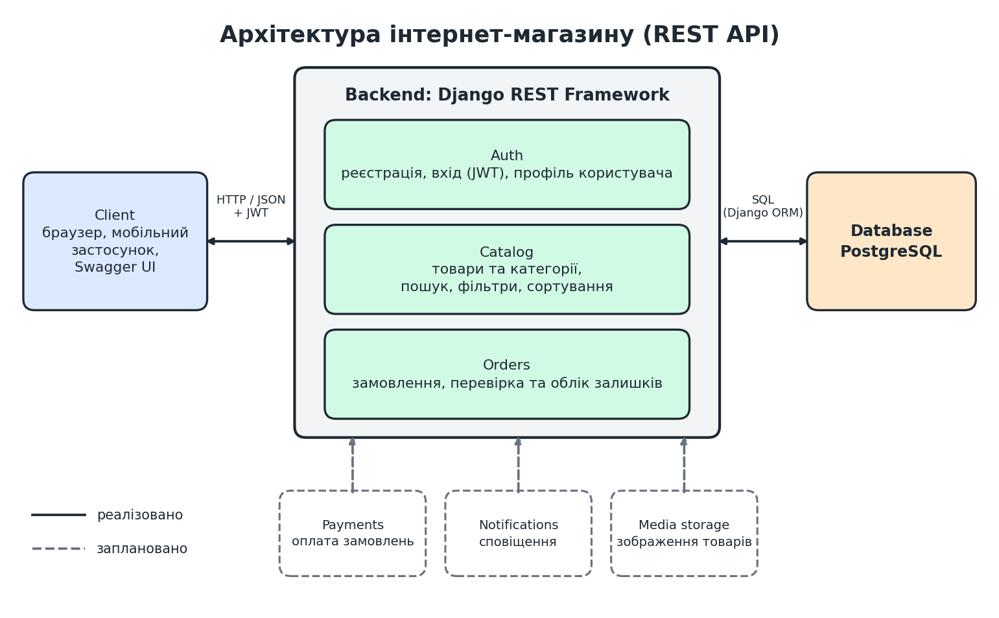

# Бізнес-документ: REST API інтернет-магазину

## 1. Назва системи та короткий опис

**Назва:** Online Store API (REST API інтернет-магазину).

Система є серверною частиною (backend) інтернет-магазину. Вона надає клієнтським застосункам (вебсайту, мобільному застосунку, будь-якому HTTP-клієнту) програмний інтерфейс для перегляду каталогу товарів, реєстрації користувачів та оформлення замовлень. Для документації та ручного тестування API використовується Swagger UI.

Ключові ідеї проєкту: каталог з пошуком і фільтрами, безпечна авторизація на основі JWT-токенів, цілісність замовлень (ціна фіксується на момент покупки, залишки на складі враховуються транзакційно) та ізоляція даних користувачів, коли кожен бачить лише власні замовлення.

Проєкт розробляється як навчальний, але з дотриманням практик, близьких до реальної розробки: робота через Git, pull requests, автотести, конфігурація через змінні оточення, документація API.

## 2. Користувачі (ролі)

| Роль | Опис | Що може |
|---|---|---|
| **Гість** | Неавторизований відвідувач | Переглядати каталог товарів і категорій, шукати та фільтрувати, реєструватися, входити |
| **Покупець** | Зареєстрований користувач | Усе, що гість, а також керувати своїм профілем, створювати замовлення, переглядати свої замовлення |
| **Адміністратор** | Співробітник магазину (`is_staff`) | Керувати товарами, категоріями та статусами замовлень (зараз через адмін-панель Django, через API заплановано) |

## 3. Основні сценарії використання

**Сценарій 1. Перегляд та пошук товарів.** Гість відкриває каталог, обирає категорію, шукає товар за назвою, сортує за ціною та відкриває сторінку конкретного товару.

**Сценарій 2. Реєстрація та вхід.** Користувач створює акаунт (логін, email, пароль), після чого входить і отримує пару токенів `access` та `refresh`. Токен `access` додається до запитів, захищених авторизацією.

**Сценарій 3. Оформлення замовлення.** Покупець надсилає список товарів із кількістю. Система перевіряє, що товари доступні, а залишку достатньо, фіксує ціни, зменшує залишки та створює замовлення зі статусом `PENDING`. Якщо хоча б одного товару не вистачає, замовлення не створюється взагалі.

**Сценарій 4. Перегляд власних замовлень.** Покупець відкриває список своїх замовлень або одне з них і бачить позиції, ціни та загальну суму. Замовлення інших користувачів недоступні.

**Сценарій 5. Керування каталогом.** Адміністратор додає, редагує та ховає товари й категорії (зараз в адмін-панелі, у планах через API).

## 4. Функціональні вимоги

Позначки: **[готово]** реалізовано, **[план]** заплановано.

**Каталог**
- Система повинна віддавати список активних товарів і категорій та окремий товар за ідентифікатором. **[готово]**
- Система повинна підтримувати фільтр за категорією, пошук за назвою та сортування за ціною та датою додавання. **[готово]**
- Система повинна дозволяти адміністратору створювати, змінювати та видаляти товари й категорії через API. **[план]**
- Система повинна підтримувати зображення товарів. **[план]**
- Система повинна розбивати довгі списки на сторінки (пагінація). **[план]**

**Користувачі та авторизація**
- Система повинна дозволяти зареєструвати користувача з унікальними логіном та email. **[готово]**
- Система повинна видавати JWT-токени за логіном і паролем та оновлювати їх. **[готово]**
- Система повинна дозволяти користувачу переглядати та змінювати власний профіль (адреса, телефон тощо). **[готово]**

**Замовлення**
- Система повинна створювати замовлення з кількома позиціями для авторизованого користувача. **[готово]**
- Система повинна визначати ціну позиції та статус замовлення на боці сервера. **[готово]**
- Система повинна перевіряти залишок і зменшувати його при створенні замовлення, а при помилці відкочувати всі зміни. **[готово]**
- Система повинна показувати користувачу лише його власні замовлення. **[готово]**
- Система повинна підтримувати кошик. **[план]**

**Документація та якість**
- Система повинна надавати інтерактивну документацію API (Swagger, ReDoc). **[готово]**
- Ключова логіка повинна бути покрита автотестами. **[частково]**

## 5. Нефункціональні вимоги

- **Безпека.** Паролі зберігаються лише у вигляді хешів і ніколи не повертаються в API. Авторизація за JWT. Секретні дані (ключ Django, доступ до бази) зберігаються у змінних оточення, а не в коді. Клієнт не може задати службові поля (права, статус, ціну). Доступ до даних обмежений власником.
- **Цілісність даних.** Створення замовлення виконується в одній транзакції. Історичні дані захищені від випадкового видалення (`PROTECT`), а ціна в замовленні фіксується окремо від поточної ціни товару.
- **Швидкодія.** Зв'язані дані завантажуються пакетно, щоб уникнути зайвих запитів до бази (`prefetch_related`). Для великих списків планується пагінація.
- **Зручність для розробників та клієнтів.** Єдиний REST-стиль, зрозумілі коди відповідей (401, 403, 404, 405), документація Swagger.
- **Підтримуваність.** Чітка структура проєкту, залежності у `requirements.txt`, конфігурація через `.env`, код у Git, зміни через pull requests.
- **Тестованість.** Основні сценарії перевіряються автоматичними тестами (`python manage.py test`).

## 6. Обмеження (чого система точно не робитиме)

- Не містить користувацького інтерфейсу: це лише API, вебсайт чи мобільний застосунок розробляються окремо.
- Не виконує реальних платежів. Інтеграція з платіжними системами поза поточним обсягом.
- Не інтегрується зі службами доставки.
- Не надсилає email чи інші сповіщення на цьому етапі.
- Не дозволяє покупцю змінювати або видаляти оформлене замовлення через API. Статуси замовлень змінює лише адміністратор.
- Не підтримує кілька валют, знижки, промокоди та відгуки про товари.
- Не розрахована на високі навантаження: навчальний проєкт без масштабування та кешування.

## 7. Архітектура системи

Система має класичну клієнт-серверну архітектуру: клієнт звертається до backend за HTTP, а backend зберігає дані в базі.

**Опис блоків:**

- **Client.** Будь-який застосунок, що користується API: браузер, мобільний застосунок або Swagger UI. Надсилає HTTP-запити, а дані передаються у форматі JSON. Для захищених запитів додає JWT-токен у заголовок `Authorization`.
- **Backend (Django + Django REST Framework).** Серверна частина, що приймає запити, перевіряє права доступу, виконує бізнес-логіку та повертає відповіді. Складається з модулів:
  - **Auth**: реєстрація, вхід, видача й оновлення JWT-токенів, профіль користувача;
  - **Catalog**: товари та категорії, пошук, фільтри й сортування;
  - **Orders**: створення замовлень, перевірка та облік залишків, перегляд власних замовлень.
- **Database (PostgreSQL).** Зберігає користувачів, категорії, товари, замовлення та їхні позиції. Backend працює з базою через Django ORM.
- **Payments (план).** Майбутній модуль онлайн-оплати замовлень.
- **Notifications (план).** Майбутній модуль сповіщень (наприклад, email про зміну статусу замовлення).
- **Media storage (план).** Майбутнє сховище для зображень товарів.
